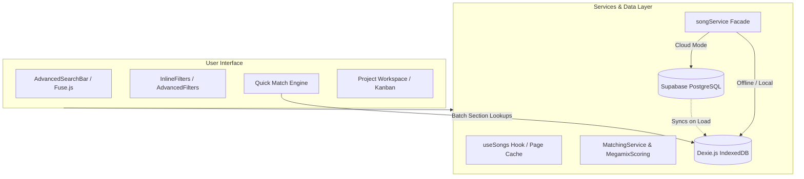
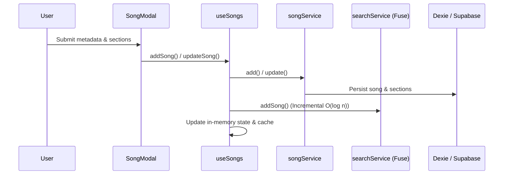
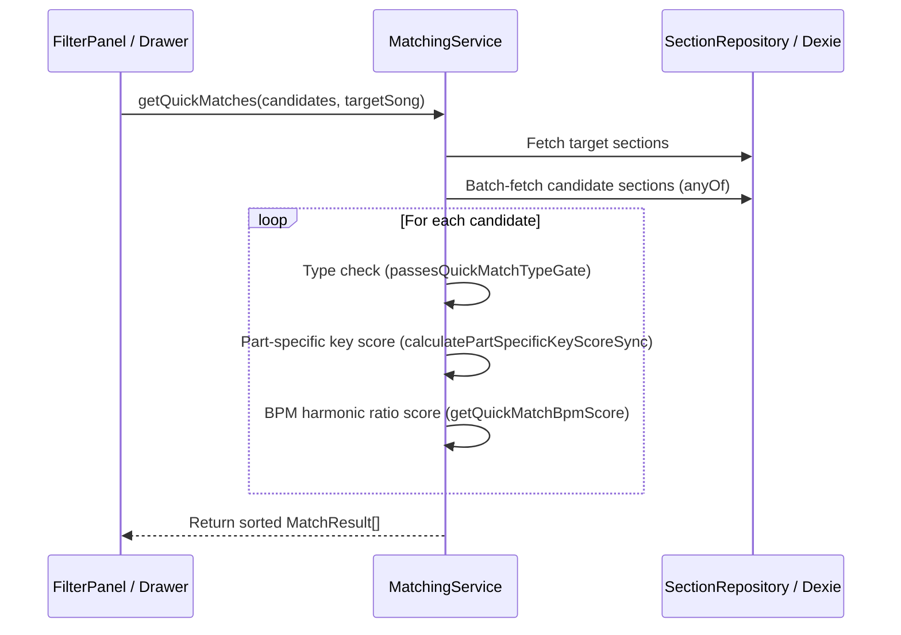

# MashHub Architecture & Developer System Brain

> **Quick Context for Engineers & AI Agents**:
> This document is the unified technical and architectural brain for MashHub. It combines high-level system architecture, data models, file indexing, runtime invariants, and performance optimization roadmaps.

---

## 1. Executive Summary & Core Purpose

MashHub is a high-performance web application designed for mashup artists, music producers, and DJs. It enables users to:
1. **Catalog songs** with section-level musical metadata (BPM, Camelot/traditional musical Key, parts like Verse, Chorus, Bridge, etc.).
2. **Execute Quick Match & Harmonic Search** to find candidate vocal/instrumental tracks compatible with a given target song or project section.
3. **Manage multi-track mashup projects** (Seasonal, Year-End, Song-Megamix) with Kanban and Spreadsheet views.
4. **Run in a hybrid persistence mode**: Local-first via IndexedDB (Dexie.js) and Cloud via Supabase (PostgreSQL, Row Level Security, Auth).

---

## 2. Architecture & Tech Stack

- **Frontend Core**: React 19, TypeScript, Vite, Tailwind CSS, React Router.
- **Client Storage**: Dexie.js (IndexedDB wrapper) with schema versioning and bulk-loading mechanisms.
- **Cloud Database / BaaS**: Supabase (PostgreSQL, Row Level Security, RPCs, GoTrue Auth).
- **Search Engine**: In-memory Fuse.js singleton with incremental mutation updates (`add`, `remove`, `setCollection`).
- **Harmonic & Musical Engine**: Camelot wheel calculations, modulation proximity, pitch class normalization, fuzzy BPM membership functions.
- **Interactive UI**: Framer Motion for transitions, `@dnd-kit` for drag-and-drop Kanban manipulation, Recharts for analytics.

---

## 3. Fast Directory & File Map

| Path | Purpose / Responsibilities |
|---|---|
| `src/services/songService.ts` | Facade for songs API: handles Supabase vs Dexie fallback, enriched mapping, page queries. |
| `src/services/matchingService.ts` | Quick Match algorithms, harmonic scoring, part-specific key/BPM scoring, `passesQuickMatchTypeGate`. |
| `src/services/database.ts` | Dexie schema, migrations, `MashupDatabase` class, `dexieSongService`, `sectionService`. |
| `src/services/sectionRepository.ts` | In-memory TTL cache (`sections:{songId}`) and batched `anyOf` fetchers for song sections. |
| `src/services/projectService.ts` | Projects, project sections, and Kanban/Spreadsheet entry persistence. |
| `src/services/searchService.ts` | Singleton Fuse.js engine for fuzzy search; incremental updates (`addSong`, `removeSong`). |
| `src/hooks/useSongs.ts` | Primary hook managing song library state, pagination, CSV seeding, and reload actions. |
| `src/hooks/useProjects.ts` | Project state hook, section ordering, and project entries. |
| `src/utils/bpmMatching.ts` | BPM compatibility, harmonic ratios (half-time, double-time, $3/2$ triplets), and scoring formulas. |
| `src/utils/keyNormalization.ts` | Camelot notation parsing, pitch class conversion, enharmonic spelling, harmonic wheel steps. |
| `src/utils/megamixScoring.ts` | Complex scoring engine for multi-track megamixes and transition compatibility. |
| `src/utils/suggestionPaneSongs.ts` | Pre-filters and ranks candidates for project workspace suggestion sidebars. |
| `src/components/SongList.tsx` | Main library table/grid view with virtualized or paginated items. |
| `src/components/InlineFilters.tsx` | Fast interactive BPM, Key, Type filter bar on the main page. |
| `src/components/AdvancedFiltersDialog.tsx` | Complex modal dialog for harmonic ranges, part-specific keys, and multi-criteria filters. |
| `src/pages/ProjectWorkspacePage.tsx` | Core mashup project workspace with Kanban board, audio suggestions, and section flows. |
| src/pages/LyricMatchPage.tsx | Standalone lyric matching page (/lyrics) supporting Compare Selected & One vs Library. |
| src/services/lyricMatchEngine.ts | Pure TypeScript grouping engine (n-grams 1..4, maximal-phrase rule, rarity ranking). |
| src/services/lyricsService.ts | Client service for lyric ingestion, candidates lookup, coverage stats, and semantic pairs. |
| src/services/lyricLinkService.ts | Persistent cross-view lyric links synced between Supabase and Dexie. |
| `supabase/migrations/` | SQL schema definitions, indexes, RLS policies, and RPC functions. |
| `docs/` | Structured documentation hub (architecture, features, guides, troubleshooting, research). |

---

## 4. Core Domain Invariants & Rules

1. **Section-First Architecture**:
   - Songs do not hold BPM/Key directly in persistence tables; these are normalized in `song_sections`.
   - In frontend models, `Song` is enriched with `bpms: number[]`, `keys: string[]`, `primaryBpm`, and `primaryKey` (derived from `sectionOrder === 1`).
   - Never snap or round BPM values: always preserve float precision.
2. **Hook Safety & Determinism**:
   - All React hooks must run at the top level unconditionally. No hooks inside conditions, loops, or early returns.
   - Branching behavior is handled inside hooks via enabled flags (see [`docs/architecture/hook-safety.md`](docs/architecture/hook-safety.md)).
3. **Harmonic Key Matching Rules**:
   - **Camelot Proximity**: Compatible if $\Delta \le 1$ on the wheel (e.g. `8A` matches `7A`, `8A`, `9A`, `8B`).
   - **Modulation Exception**: Key mismatch in *Last Chorus* sections must never penalize overall match score if modulation is detected.
4. **Offline / Cloud Fallback**:
   - Queries evaluate backend availability via `withFallback` or verify `isLocal` before initiating direct Supabase calls.
   - The system must remain fully operational even if Supabase is unreachable.

---

## 5. Subsystems & Data Lifecycle

### Data Flow Cheat Sheet

#### When a Song is Added or Updated:

#### When Quick Match is Evaluated:

---

## 6. Performance Hotspots & Guidelines

| Hotspot | Anti-Pattern | Recommended Practice |
|---|---|---|
| **Full DB Queries** | Calling `songService.getAll()` or `fetchAllFromSupabase()` indiscriminately. | Use `getListPage(page, pageSize)` or query specific song IDs via `getByIds()`. |
| **Section Fetching** | Querying sections in a loop (`for (const s of songs) db.songSections.get(...)`). | Use `sectionRepository.getForSongs(ids)` (single `anyOf` query with TTL caching). |
| **Fuse Search Rebuild** | Instantiating `new Fuse(songs)` on single item mutations. | Call `searchService.addSong(song)` or `removeSong(id)` to update incrementally. |
| **Key Normalization** | Parsing keys via ad-hoc string regex/substring. | Use `canonicalizeKeyString()` from `src/utils/keyNormalization.ts`. |
| **Quick Match Prefilter** | Passing all 8,000+ library songs to `getQuickMatches`. | Pre-filter candidates by BPM range ($\pm 15\%$) and compatible Camelot keys before scoring. |

---

## 7. Architectural Optimization Blueprint

### Phase 1: Local-First Stale-While-Revalidate (SWR) Sync
- Store library data locally in Dexie as the single source of client read truth.
- On startup, immediately load Dexie cache (< 50ms startup).
- In background, check for updates against Supabase (`updated_at > :lastSyncTimestamp`).

### Phase 2: Index-First Database Queries
- Pre-filter by BPM range and compatible Camelot keys *before* loading rows into memory.
- Reduce candidate count from 8,000+ songs to 50–200 candidates using compound indexes.

### Phase 3: Server-Side Filtering & Postgres RPCs
- In Cloud mode without local cache, delegate Quick Match candidate generation to a Postgres RPC (`get_quick_matches`).

### Phase 4: Virtualized & Cursor-Paginated Rendering
- Retain pagination/virtualization for library views (`SongList`).
- Feed `AdvancedSearchBar` with pre-indexed tokens as the library scales beyond 10k tracks.

---

## 8. Testing & Verification

- **Run all unit tests**: `npm run test` or `npx vitest run`
- **Key test suites**:
  - `src/test/camelot.test.ts`: Camelot key and pitch-class normalization tests.
  - `src/test/compatibilityScore.test.ts`: Quick Match pair scoring formulas.
  - `src/test/dexieCrud.test.ts`: IndexedDB schema, sections, and CRUD transactions.
  - `src/test/searchService.test.ts`: Fuse.js incremental index operations.
